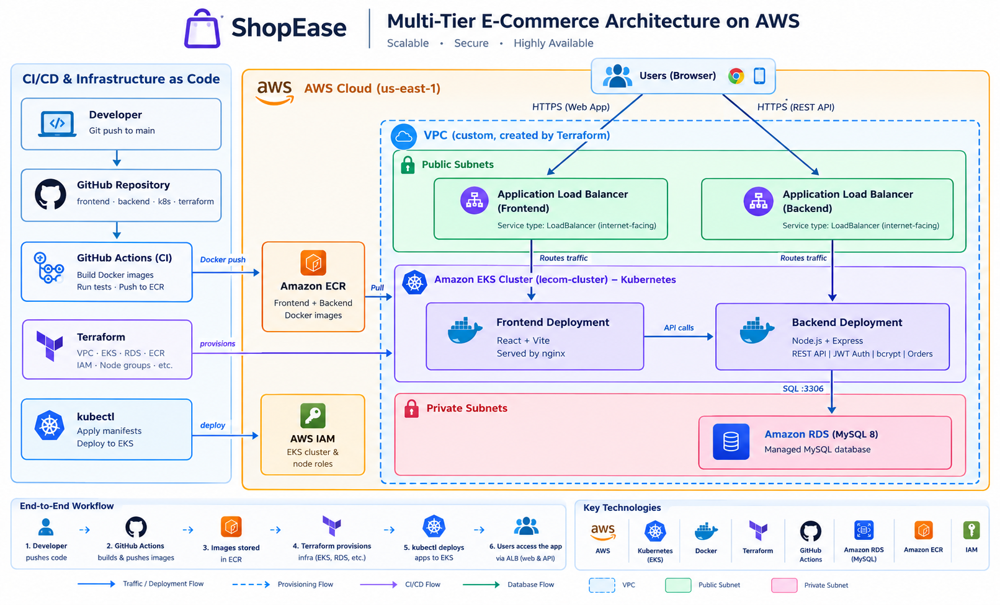

# Documentation

## Architecture Diagram

This diagram shows how ShopEase is built and deployed on AWS.

### CI/CD flow
1. A developer pushes code to the `main` branch on GitHub.
2. GitHub Actions builds the Docker images for the frontend and backend.
3. The images are pushed to Amazon ECR.
4. `kubectl apply` deploys the manifests in `k8s/` to the EKS cluster, which pulls the images from ECR.

### Runtime flow
1. Users open the web app through an Elastic Load Balancer that exposes the frontend (React + nginx).
2. The frontend calls the backend REST API through a second Elastic Load Balancer.
3. The backend (Node.js + Express) handles authentication and orders.
4. The backend connects to Amazon RDS (MySQL), which sits in private subnets.

### Infrastructure
All AWS resources (VPC, subnets, RDS, ECR, EKS, IAM) are created with Terraform from the `terraform/` folder.
